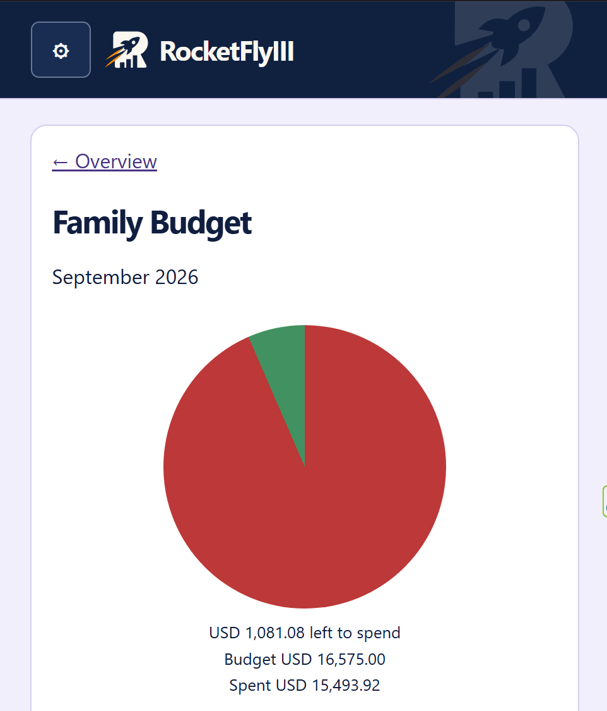

# RocketFlyIII

RocketFlyIII is a self-hosted, read-only dashboard for households that manage their finances in Firefly III. See where your money went, how much is left in each budget, and which subscription payments to expect next.

## What it does

- **Follow a budget through the month.** See how much you’ve spent and how much is left. Open a budget to see when spending picked up and which transactions contributed.
- **Understand account activity.** Review balances and transactions, and see income, spending, and transfers separately. You can count incoming transfers as income in an account chart when that reflects how you fund the account.
- **Keep track of subscriptions.** See which subscriptions are active, how much you’ve paid this period, and when the next payment is expected.
- **Share a household view.** Give each person a local profile and choose which accounts and budgets they can see.

  

## Why RocketFlyIII exists

A balance tells you what’s in an account. Planning the rest of the month takes a little more context. RocketFlyIII lets you review upcoming subscription payments alongside what your household has already spent. If a budget looks tight, you can follow the spending back to individual transactions. Everyone works from the same Firefly III records, with a view tailored to the accounts and budgets they can access.
